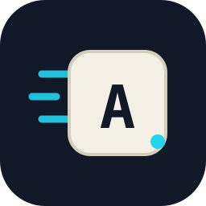

<p align="center">
  
</p>

# dsh-typing-practice

**简体中文** | [English](README.en.md)

给 [DeepSeek Harness](https://github.com/deepseek-ai/deepseek-harness) Web GUI 加的「打字练习」插件：英文、中文和粤语文本练习，可选默认语料或近期本地对话，使用自己的输入法上屏，可查看拼音或粤拼提示，实时统计速度与准确率，提供机械键盘音效选择，最佳成绩和练习历史存在本机浏览器。

> 非官方 DeepSeek Harness 插件。

## 功能

| 功能 | 说明 |
|---|---|
| 语言 | 英文、简体中文、繁体粤语，与界面语言独立 |
| 语料 | 每种语言 96 篇原创短文，也可使用近 30 天的本地对话 |
| 练习方式 | 15／30／60 秒限时练习，或短篇／中篇／长篇完整文本练习 |
| 输入 | 使用自己的输入法；中文和粤语可显示拼音／粤拼提示 |
| 实时反馈 | 沉浸式正文，当前输入行保持固定高度，前后文字逐渐淡出 |
| 统计 | 正文上方显示速度、准确率、错误和时间；英文用 WPM，中文与粤语用字/分钟（CPM） |
| 记录 | 保存本机最佳成绩和最近 100 次练习，可按语言筛选、查看同篇记录或清空 |
| 设置 | 光标、注音和键盘音效集中设置，选项保存在本机浏览器 |
| 界面 | 中英双语，跟随 DSH 界面语言及亮／暗主题 |

## 语料与练习方式

默认语料共 **288 篇，三种语言各 96 篇，短／中／长各 32 篇**，覆盖八类主题。每种语言包含 32 个场景，每个场景提供三个篇幅的完整版本：中篇补充事件发展，长篇进一步展开细节和后续。三档均可独立练习。中文为简体，粤语为繁体口语文本。

| 篇幅 | 英文词数范围 | 中文／粤语可见字符范围 | 每语种数量 |
|---|---:|---:|---:|
| 短篇 | 40–79 | 80–159 | 32 |
| 中篇 | 80–139 | 160–279 | 32 |
| 长篇 | 140–220 | 280–440 | 32 |

在页面下方选择语言和练习方式：`英文／中文／粤语 | 15 秒／30 秒／60 秒 | 短篇／中篇／长篇`。语言和练习方式各自单选。默认练习语言与 DSH 界面语言一致。

拼音与粤拼词库随插件提供，在本地加载，不调用远程注音服务。加载失败时可重试，或关闭注音继续练习。

在「设置 → 注音」中选择显示范围，以及中文的全拼或双拼提示。默认全拼；双拼可选小鹤、自然码、微软和搜狗，方案应与自己的输入法保持一致。选项保存在本机，切换到中文时自动应用；粤语仍显示粤拼。

### 本地对话语料

在页面下方选择「本地对话语料」，插件会按当前英文／中文／粤语模式选取文本，点击「换一段」可重新选取。插件会记住来源选项；首次使用默认为「默认语料」。没有合适的本地内容时，自动切回默认语料。

本地对话只使用当前 DSH profile 近 30 天的用户正文和已完成的模型回复，不区分两种角色。短篇／中篇／长篇按上表档位选取完整片段；限时模式会在开始前准备好所需文本。

## 键盘音效

打开右上角「设置」的「音效」分组，可选 Cherry MX Blue、Cherry MX Brown、NovelKeys Cream 和 Holy Panda。点击「试听」预览，用音量滑块调整大小。音效默认关闭，初始音量 30%；音色和音量会自动保存。练习进行中暂时禁用设置入口，结束或重新开始后可调整。

四套声音来自 [kbsim](https://github.com/tplai/kbsim) 的 MIT 许可录音，随插件提供。这些录音来自具体键盘配置，不代表所有同名轴体的声音。来源和许可见[第三方声明](THIRD_PARTY_NOTICES.md)。

## 常用操作

- 点击正文或用 `Tab` 聚焦后输入，使用自己的输入法完成中文或粤语上屏。
- 「重新开始」或 `Esc`：重练当前文本。
- 「换一段」：macOS 使用 `⌘ R`，Windows／Linux 使用 `Ctrl+R`。悬停按钮可查看快捷键。
- 切换选项：macOS 使用 `⌘ T` 切换语言、`⌘ D` 切换时长、`⌘ L` 切换篇幅；Windows／Linux 将 `⌘` 换为 `Ctrl`。悬停对应选项组可查看快捷键。
- 「记录」：查看最佳成绩和练习历史。练习结束或重新开始后可打开。
- 弹窗内按 `Esc` 关闭；使用 `Tab` / `Shift+Tab` 在控件间移动。

## 网页版与开发源码

[字感网页版](https://typefeel.app) 可直接在浏览器中使用。

插件与网页的开发源码统一维护在 [yishan/typefeel](https://github.com/yishan/typefeel)。本仓库提供可直接安装的插件构建产物，功能修改与测试在源码仓库进行。发布包中的 `SOURCE.json` 记录对应的源码提交。

## 安装

本插件是 DSH 的 bundle，可在插件管理中通过 GitHub 仓库安装：

```text
https://github.com/yishan/dsh-typing-practice
```

如果环境中有 `dsh` CLI，可从 npm 安装：

```bash
dsh plugin --profile <profile> add dsh-typing-practice
```

也可以通过 CLI 从 GitHub 安装：

```bash
dsh plugin --profile <profile> add github:yishan/dsh-typing-practice
```

安装后刷新 DSH Web 页面，左侧栏会出现「打字练习」。Host、注音与音效均已打包，无需源码目录、手动安装依赖或自行构建。插件安装在所选 DSH profile 下，该 profile 的所有会话均可使用。

更新后，可在插件管理页关闭再开启「打字练习」，然后刷新页面。卸载时使用 `plugin_manager`。

## 许可

[MIT](LICENSE)。随包注音依赖和键盘录音的版本、来源和许可见 [THIRD_PARTY_NOTICES.md](THIRD_PARTY_NOTICES.md)。

---

[](https://github.com/deepseek-ai/deepseek-harness)
